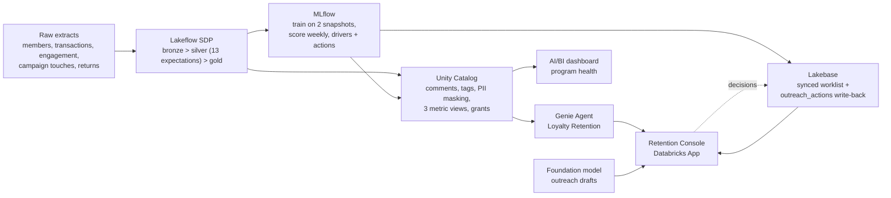

# Loyalty Lapse Propensity on Databricks

An end-to-end prototype for a specialty apparel retailer whose loyalty program is quietly losing its best members.
Everything runs in one Databricks workspace on synthetic data and ships as a single Declarative Automation Bundle.

**Customer problem.** The retailer's 400K-member loyalty program sees a spike in lapsed Gold and Silver members in the
second half of 2026. Two causes are buried in the data: a fit change on the Core Denim line (June 1) that drives
"fit" returns, and a cut to the birthday reward from $20 to $10 (July 15) that halves response rates. The CRM team only
finds out when members have already been silent for 90 days, which is too late to win them back cheaply.

**What the build does.** Lands the raw extracts, governs them in Unity Catalog, predicts which regular shoppers will
go silent in the next 90 days, serves that worklist from Lakebase to a retention console that writes decisions back,
and lets analysts ask the Genie Agent questions in plain English against governed metric views.

## Requirements checklist

| Requirement | Where it is met |
|---|---|
| Specific industry problem | Specialty apparel retail: loyalty members lapsing after a product-fit change and a reward devaluation. On the FY27 Retail Industry Outcome Map this sits under the business outcome "Respond & Predict to Customer Behavior in Real Time", use-case domains "Unified Customer View" (Customer 360) and "Actionable Customer Understanding" (Behavioral Segmentation, Customer Lifetime Value) |
| Raw dataset, synthetic or public | Seven synthetic extracts generated on serverless by `src/generate/generate_synthetic_data.py`, landed as CSV/JSON files in a UC volume |
| Lakeflow ingests the raw data | Serverless Spark Declarative Pipeline with Auto Loader, 7 bronze streaming tables, 13 expectations (`src/pipeline/`) |
| Unity Catalog governs it | Column comments, tags, PII masking, grants, three metric views, UC model registry, lineage (`src/governance/`, `evidence/04_*`, `evidence/09_lineage.md`) |
| Lakebase for operational serving | Synced worklist read by the app in milliseconds, decisions written back, refreshed automatically after each scoring run (`src/lakebase/`, `evidence/05_*`) |
| ML or Gen AI | MLflow lapse model with temporal hold-out and calibration (`MODEL.md`), plus a foundation model drafting outreach in the app |
| Genie Agent | "Loyalty Retention" agent on the metric views; 6 conversation answers and a 4 of 4 benchmark run (`src/genie/`, `evidence/06_*`) |
| Databricks App | Streamlit retention console with worklist, write-back, AI drafts and embedded Genie (`src/app/`, `evidence/07_*`); AI/BI dashboard as a second business surface (`evidence/08_*`) |
| Integrated, not siloed | One bundle; UC lineage shows 40 recorded edges from bronze to the Lakebase sync (`evidence/09_lineage.md`) |
| Execution evidence readable as text | Executed notebook outputs, event-log queries, API responses, logs and query results committed under `evidence/`; indexed below |
| No customer data | Everything synthetic; no customer names, identifiers or records anywhere in the repo |
| Deck | `deck/loyalty_lapse_deck.pdf` (export of the Google Slides deck), outcome-led, KPIs quantified, sponsor and domain owner addressed |

## Data journey



| Stage | What runs | Where |
|---|---|---|
| Lakeflow | Serverless Spark Declarative Pipeline: Auto Loader bronze (7 sources) > typed silver with 13 expectations > gold member 360 and member-month activity | `src/pipeline/*.sql`, `resources/loyalty_pipeline.pipeline.yml` |
| Unity Catalog | Column comments on every gold column, `business_area` / layer / certified tags (prefixed `lp_` because the shared metastore enforces tag policies on the common keys), PII column tags, email masking for non-admins, three governed metric views, least-privilege grants | `src/governance/apply_governance.py` |
| ML | Point-in-time features from two historical snapshots, HistGradientBoosting classifier in MLflow, registered in UC as `loyalty_lapse_model@champion`, temporal hold-out evaluation with calibration check, batch scoring with plain-language risk drivers and recommended actions. Runs weekly (Monday 06:00 Central) and refreshes the Lakebase worklist as its last task | `src/ml/features.py`, `src/ml/train_lapse_model.py`, `src/ml/score_members.py`, `resources/train_score.job.yml`, `MODEL.md` |
| Lakebase | Project `loyalty-lapse`; `member_retention_scores` synced from Delta into Postgres (triggered sync, refreshed by the scoring job); the app writes `retention_app.outreach_actions` back to the same database | `src/lakebase/create_synced_table.sh`, `src/lakebase/grant_app_access.py` |
| Genie Agent | "Loyalty Retention" agent on the three metric views plus two gold tables, with instructions, example SQL and benchmarks committed as a reproducible payload; benchmark evaluation run scores 4 of 4 | `src/genie/build_genie_agent.py`, `src/genie/deploy_genie_agent.sh` |
| AI/BI dashboard | "Loyalty program health and lapse risk": KPIs, lapse by tier and store format, monthly trends with the two event annotations, revenue at risk by driver, worklist table, global filters, Genie linked | `src/dashboard/loyalty_program_health.lvdash.json`, `src/dashboard/deploy_dashboard.sh` |
| Databricks App | Streamlit retention console: program KPIs from the metric views, Lakebase worklist with approve / suppress / contacted write-back, AI-drafted outreach messages from a foundation model endpoint (grounded in the member's driver and action, never mentions scores), embedded Genie chat, outreach log | `src/app/`, `resources/retention_app.app.yml` |

Synthetic source data is produced by `src/generate/generate_synthetic_data.py` (Spark + Faker on serverless) into a
UC volume as CSV and JSON files, the way a loyalty platform, POS, analytics SDK, campaign tool and returns desk would
deliver them.

## Execution evidence (text, committed)

| File | What it shows |
|---|---|
| `evidence/01_generate_synthetic_data.md` | Executed generator notebook with cell outputs: row counts, tier mix, denim return-rate spike, birthday response collapse, cohort active-buyer decline |
| `evidence/01_generate_job_run.log` | Job run log for the generator |
| `evidence/02_pipeline_run.log` | Lakeflow pipeline update log (all flows COMPLETED) |
| `evidence/02_pipeline_tables.md` | Row counts per table, expectation pass/fail counts from the pipeline event log, gold sanity query |
| `evidence/03a_train_lapse_model.md` | Executed training notebook: lapse rates by snapshot, hold-out metrics, decile table, model registration, permutation importance |
| `evidence/03b_score_members.md` | Executed scoring notebook: risk band distribution, drivers, top members by value at risk |
| `evidence/04_governance.md` | Executed governance notebook: comments applied, tags, metric view queries, grants |
| `evidence/05_lakebase.md` | Synced table status, queries against the synced Postgres table, and the `retention_app.outreach_actions` rows the console wrote back, all read through the `loyalty_lakebase` federation catalog |
| `evidence/05b_lakebase_grants.md` | Executed notebook: GRANTs to the app service principal over the Postgres wire protocol, tables visible in Postgres, write-back table contents |
| `evidence/05_lakebase_sync.log`, `evidence/05b_lakebase_grants_run.log` | CLI output for synced table creation and the grants job run |
| `evidence/06_genie_agent.md` | Genie Agent creation output and Conversation API answers to the benchmark questions |
| `evidence/07_app.md` | App deployment status, injected Lakebase variables, user activity from the log |
| `evidence/08_dashboard.md` | AI/BI dashboard creation and publish state |
| `evidence/09_lineage.md` | Unity Catalog `system.access.table_lineage` graph: 40 recorded source-to-target edges from bronze through silver, gold, metric views, feature sets, scores and the Lakebase synced table, proving the stages are integrated rather than siloed |

## Reproduce

```bash
# 0. profile for an AWS serverless workspace; edit databricks.yml variables (catalog, warehouse_id, lakebase_project)
databricks bundle validate -t dev --profile <P>
databricks bundle deploy -t dev --profile <P>

# 1. raw data -> 2. pipeline -> 3. model + scores -> 4. governance + metric views
databricks bundle run generate_synthetic_data -t dev --profile <P>
databricks bundle run loyalty_pipeline -t dev --profile <P>
databricks bundle run train_and_score -t dev --profile <P>
databricks bundle run apply_governance -t dev --profile <P>

# 5. Lakebase project + synced worklist (needs CREATE CATALOG on the metastore once)
databricks postgres create-project loyalty-lapse --json '{"spec": {"display_name": "Loyalty Lapse Retention"}}' --profile <P>
databricks postgres create-catalog loyalty_lakebase --json '{"spec": {"postgres_database": "databricks_postgres", "branch": "projects/loyalty-lapse/branches/production"}}' --profile <P>
src/lakebase/create_synced_table.sh <P>

# 6. Genie Agent, then 7. the app with the Genie space id (set it in resources/retention_app.app.yml or pass --var)
src/genie/deploy_genie_agent.sh <P> <warehouse_id>            # prints GENIE_SPACE_ID
databricks bundle deploy -t dev --profile <P> --var genie_space_id=<id>
databricks bundle run retention_console -t dev --profile <P>
databricks bundle run lakebase_grant_app_access -t dev --profile <P>   # lets the app's service principal read the synced worklist

# 8. AI/BI dashboard
src/dashboard/deploy_dashboard.sh <P> <warehouse_id>
```

## Deck

The business deck is a 12-slide Google Slides presentation on the Databricks template, built by `deck/build_gslides.py`
(Slides API; tables, a native architecture diagram, template layouts). `deck/loyalty_lapse_deck.pdf` is the PDF export
of that deck. `deck/loyalty_lapse_deck.md` is the narrative outline the slides follow.

## Results

See `RESULTS.md` for the numbers quoted in the deck, each with the evidence file it comes from.

## Notes

- All data is synthetic. No customer records, names, or identifiers appear anywhere in this repository.
- The model population is regular shoppers (2 or more purchases in the trailing 180 days). For lighter buyers a 90-day
  gap is normal cadence, not lapse, so scoring them would only add noise and waste retention budget.
- `loyalty_gen.member_truth` holds the generator's hidden cohort and lapse dates. It exists only to prove the signal was
  planted; the pipeline, model and Genie Agent never read it.
