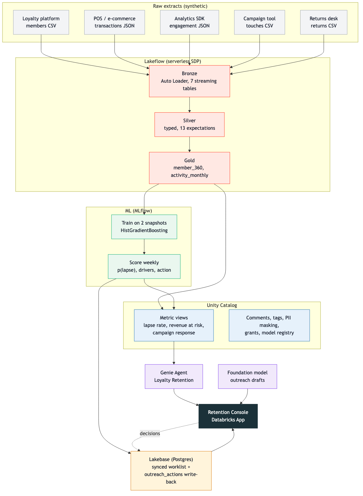

# Stop the quiet lapse

**Predicting which loyalty members go silent next, and acting 60 days earlier**

Specialty apparel retail | Prototype built on Databricks | November 2026

Audience: SVP Customer & Loyalty (executive sponsor) and Director of CRM & Retention Marketing (domain owner)

---

## The problem in one line

Our best members do not cancel. They just stop coming back, and we find out 90 days later.

- 400K loyalty members. Gold and Silver are 30% of members and 67% of trailing-12-month spend.
- $27.1M of trailing-12-month spend now sits with members who have not bought in 90 days or more. $13.9M of that is Gold and Silver.
- The second half of 2026 brought a lapse wave concentrated in Gold and Silver members whose home store is in a mall: 38% lapsed, against 27% for the same tiers elsewhere.
- Today's win-back campaign fires at the 90-day mark, when the member is already gone and the offer has to be deep.

---

## What the data said when we finally looked

Two operational decisions in June and July quietly broke the program for the most valuable segment.

| Date | Event | Signal in the data |
|---|---|---|
| Jun 1 | Core Denim fit change | Denim return rate 7 to 8% in spring, 22% from July on, 70% coded "fit" |
| Jul 15 | Birthday reward cut from $20 to $10 | Response rate fell from 34.0% to 13.9% |
| Jun to Sep | Lapse wave | Mall-store Gold/Silver active buyers down 56% (6,683 to 2,962). Everyone else flat. |

The leading indicator was there all along: members go quiet in the app and email 30 to 60 days before their last purchase.

---

## What we built

An integrated data journey, not another dashboard. Each stage feeds the next and the retention team closes the loop.

1. **Lakeflow** lands loyalty, POS, engagement, campaign and returns extracts into bronze, silver and gold, with 13 data quality rules enforced in the pipeline (0 failed records).
2. **Unity Catalog** governs it: every gold column described, PII tagged and masked for non-admins, certified tables, and one definition of "lapse rate" and "revenue at risk" in governed metric views.
3. **MLflow model** predicts the chance a regular shopper buys nothing in the next 90 days, with plain-language drivers and a recommended action per member.
4. **Lakebase** serves the ranked worklist to the console from Postgres and stores every approve, suppress or contacted decision.
5. **Genie Agent** answers the CRM team's questions in English against the governed metrics, showing its SQL.
6. **Retention Console** (Databricks App) is where the team works the list, with a foundation model drafting the outreach message from the member's driver and recommended action.

---

## How it fits together

Every arrow is a real dependency in the bundle: the pipeline feeds the metric views and the model, the model feeds Lakebase and the metric views, and the console reads from Lakebase, Genie and the foundation model while writing decisions back to Lakebase.

---

## The model, in business terms

Trained on two historical snapshots (features as of Apr 30 and Jun 30), judged on a third it had never seen (features as of Jul 31, outcomes Aug to Oct).

| Metric | Result | What it means |
|---|---|---|
| Hold-out AUC | 0.72 | Ranks members well above chance on data it never trained on |
| Lift in top decile | 1.9x | The top 10% of the list lapses at 59%, against a 31% base rate |
| Lapsed spend captured | $2.4M, 15.6% of all lapsed spend | Found in 10% of the outreach volume |
| Regular shoppers scored | 101,089 | 3 or more purchases in the last 180 days |
| High risk | 1,408 members, $1.18M at risk | 89% of them are Gold or Silver at mall stores: the model found the cohort on its own |
| High + Medium risk | 37,703 members, $6.15M at risk | The addressable list for a quarter of retention work |

Top drivers: days since last engagement, 12-month purchase count, tier, home store format, lifetime purchases, denim share.

The probabilities are honest, not just well ordered: expected calibration error is 2.3 points, and members scored above 0.6 lapsed at 89% or more in the hold-out, so the High band is conservative.

---

## What the retention team sees

The console turns a score into a decision.

- **Worklist** from Lakebase: member, tier, p(lapse), driver, recommended action, value at risk, sorted by dollars. Queries return in milliseconds.
- **Recommended actions** are specific: fit-guarantee exchange for members with fit returns, restored $20 birthday reward for the devalued, app push for the disengaging, channel switch for the unresponsive.
- **Write-back**: approve, suppress or mark contacted. Every decision lands in Lakebase with who, when and why, and feeds next week's list.
- **Ask Genie**: "Which Gold members in mall stores are at high risk and what should we do?" answered from governed metrics, SQL shown.
- **Draft outreach with AI**: one click produces the push, SMS, email or associate talking points for that member, grounded in the driver and the recommended action. It never mentions scores or risk; the team edits and sends.
- **Program health dashboard** for leadership: the same KPIs, lapse by tier and store format, the 2026 trend with both events marked, revenue at risk by driver, with Genie one click away.

---

## Value for the executive sponsor

Framed in the KPIs the loyalty P&L is measured on.

| KPI | Baseline | With early intervention | Basis |
|---|---|---|---|
| Lapsed-member spend (trailing 12M) | $27.1M | Target 15% recovered: $4.1M a year | Win-back rates of 10 to 20% are typical when contact happens before the lapse, not after |
| Incentive cost per saved member | Deep discount after 90 days of silence | Lighter, targeted offer at day 30 to 60 | Earlier contact needs a smaller incentive |
| Campaign response rate | 13.9% after the reward cut | Back toward 34% for the devalued segment | Measured before and after in our own data |
| Time to detect a segment problem | About 90 days | Days | Weekly scoring plus governed metric views |

Decision requested: fund a 90-day pilot with the CRM team on the High-risk Gold/Silver mall segment (1,260 members, $1.07M at risk), with a holdout group so the lift is measured, not assumed.

---

## Value for the domain owner

For the Director of CRM this changes the Monday morning.

- A ranked list with a reason and an action, not a 400K-row export.
- Sized to the team: High band alone is 1,408 members; filter to Gold/Silver mall and it is 1,260. Add Medium when capacity allows.
- Suppress and contacted flags stop double-touching and carry into next week's list.
- Genie replaces the ad-hoc SQL queue: lapse rate by tier, revenue at risk by driver, response rate before and after the reward cut, all answered in seconds with the SQL visible.
- Governance is already done. The same "lapse rate" appears in the console, in Genie and in finance's reporting.

---

## Why Databricks

One platform carried the whole journey, which is why it took hours rather than quarters.

- Serverless Lakeflow pipeline with declarative quality rules and no cluster management.
- Unity Catalog metric views: define each KPI once and every consumer (Genie, app, dashboard) gets the same number.
- MLflow and the UC model registry: versioned, aliased, auditable model promotion.
- Lakebase: Postgres for the operational worklist and write-back, synced from Delta with no separate ETL.
- Genie Agent: natural language over governed data, with instructions and benchmark questions checked in like code.
- Databricks Apps: the business surface sits next to the data and inherits its permissions.

---

## Next steps

1. Pilot: 90 days, High-risk Gold/Silver mall segment, holdout group, measured lift.
2. Give merchandising the fit-return signal weekly so the next fit problem is caught in days.
3. Move scoring to a weekly schedule with the Lakebase worklist refreshing automatically.
4. Extend the Genie Agent to store operations and merchandising questions on the same governed layer.

Appendix: code, run logs and committed outputs at github.com/OrrinDatabricks/loyalty-lapse-propensity
